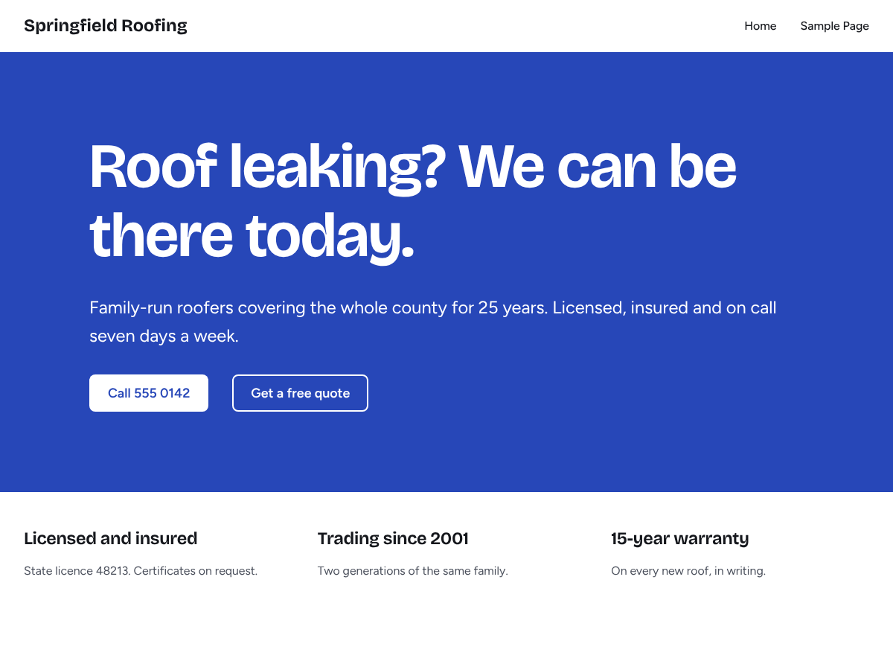

# AnyPress theme

A WordPress block theme built to be edited by people and by AI agents. Every colour, font size, space, radius and shadow is a named token in `theme.json`, sections take their colours from section styles, and every pattern says what it is for, so pages stay on-brand when the palette or fonts change.



It includes:

- **14 kits**, each a style variation, its own sections and a complete home page for one kind of business: Ridge (trades and home services), Circuit (electricians), Hearth (food and drink), Still (wellness), Ledger (professional services), Parcel (online shops), Chapter (courses and memberships), Gloss (salons and beauty), Commons (associations, chambers and churches), Rep (gyms), Frame (portfolios), Keystone (real estate), Launch (software) and Byline (blogs and magazines). Ridge and Circuit are full websites: 13 starter pages each (services, service areas, reviews, offers, quote, FAQ, careers, contact and more), a sticky header with a call button, an offer popup, FAQ, carousels, counters and a map.
- **AnyPress Blocks**: 32 sections any site can use, whatever its kit, in eight inserter groups (Heroes, About, Services and prices, Proof, Calls to action, Contact, Blog, Footers).
- **Starter pages** offered when you create a page (home pages, About, Services, Contact, sales, signup, thank-you and links pages) and **post outlines** for how-to, list and review posts.
- **Six colour palettes and four font pairings** under Appearance > Editor > Styles. Every palette keeps text at WCAG AA contrast in every section style.
- Self-hosted, open-licence fonts. Nothing loads from a font CDN.

## Requirements

WordPress 7.1 or later and PHP 8.1 or later. The popup, carousel, counter and map sections need the free [AnyPress Blocks](https://github.com/hamchowderr/anypress-blocks) plugin (0.2.0 or later); forms in the starter pages are placeholders for a forms plugin such as Fluent Forms.

## Install

1. Download `anypress.zip` from the [latest release](https://github.com/hamchowderr/anypress-theme/releases/latest).
2. In WordPress, go to Appearance > Themes > Add New > Upload Theme, choose the zip and activate it.

With WP-CLI:

```sh
wp theme install https://github.com/hamchowderr/anypress-theme/releases/latest/download/anypress.zip --activate
```

Each release lists the zip's SHA-256 checksum in `SHA256SUMS`.

## Using a kit

Pick the kit's style in Appearance > Editor > Styles, then start a page from the kit's home page (it is offered when you create a page). The kit's own sections are in the inserter under "Kit: ...". AnyPress Blocks work with every kit.

## Development

The theme files sit at the repository root, as WordPress installs them. `tests/` holds the checks, which run WordPress on [WordPress Playground](https://wordpress.org/playground/) inside Node, with no Docker or database:

```sh
cd tests
npm ci
npm run theme      # load the theme, validate every pattern, check contrast, render a page, take screenshots
npm run serve      # the same site, left running at http://127.0.0.1:9410 (admin / password)
npm run contrast   # only the colour contrast table
npm run demo -- ridge            # build the Ridge demo website and leave it running at http://127.0.0.1:9411
npm run demo -- ridge --check    # build it, click through the kit checklist at desktop and phone width, take screenshots
npm run demo -- circuit          # the Circuit (electrician) demo
```

A kit's demo is built by `demo/<kit>/build.php` (trade kits share `demo/trades.php`) from the kit's own pages and sections plus a sample business's words, photos, forms, menus and blog posts. Set `ANYPRESS_BLOCKS` to a local AnyPress Blocks folder to test against it instead of its latest release. The demo folder is left out of the release zip.

The check makes sure that the theme activates and WordPress reads its presets, that every pattern parses into valid blocks and uses theme tokens only (no hex colours or pixel sizes), that every pattern has a description and keywords, that every palette passes WCAG AA, and that a page with every pattern renders without PHP errors or sideways scrolling on a phone. Screenshots need Playwright with Chromium. `node shot.mjs` remakes `screenshot.png`.

`bin/build-zip.sh` builds `dist/anypress.zip` (the theme in an `anypress` folder, without the files listed in `.distignore`) and its checksum.

## Releasing

Bump `Version` in `style.css` and `Stable tag` in `readme.txt` together, and add the release to the changelog in `readme.txt`. Then push a `v<version>` tag, or run the **Release** workflow with the version. The workflow runs the theme check, builds the zip and publishes it on a GitHub release.

## License

GPLv3 or later (see [LICENSE](LICENSE)). The bundled fonts are under the SIL Open Font License 1.1; their credits and licences are listed in `readme.txt` and `assets/fonts/licenses/`.
